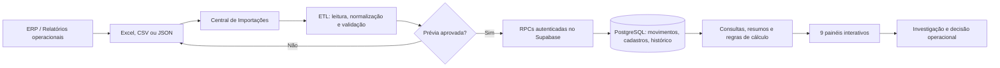

<div align="center">

# Z-AI · Gestão Visual
### Inteligência operacional para prevenção de perdas no varejo alimentar

**Transformando relatórios do ERP em indicadores confiáveis, investigação por produto e decisões de loja.**

[🌐 Abrir dashboard na Vercel](https://z-ai-dashboard-preview.vercel.app/) · [📐 Arquitetura](docs/ARQUITETURA.md) · [🔄 ETL e importações](docs/ETL_E_IMPORTACOES.md) · [📊 Dashboards](docs/DASHBOARDS_E_INDICADORES.md) · [🗺️ Roadmap](docs/ROADMAP.md)

**Piloto:** Loja **007 — Kalimera Japy** · Grupo MONTEKALI  
**Stack:** HTML · CSS · JavaScript · Python · PostgreSQL/Supabase · SQL/PLpgSQL · Vercel · GitHub

</div>

---

## O projeto em uma frase

O **Z-AI** é um dashboard executivo de prevenção de perdas que organiza **vendas, quebras reconhecidas, divergências de inventário, trocas, metas e indicadores** em um único ambiente. Em vez de preparar várias planilhas manualmente e construir gráficos isolados, o operador **seleciona a loja, escolhe o tipo de relatório e importa um arquivo do ERP**. O sistema interpreta a estrutura, valida dados, oferece uma prévia e, após confirmação, grava o resultado no banco. Os dashboards consultam a base consolidada.

> **Proposta central:** uma operação simples para o usuário; tratamento, integridade e regras analíticas explícitas nos bastidores. O Z-AI **não depende de acesso direto ao ERP** na fase atual. Os arquivos operacionais continuam sendo a origem das atualizações.

### Como funciona, de ponta a ponta



**Dois exemplos reais de fluxo:** um Excel de **vendas com vários dias** é transformado automaticamente em movimentos diários; uma planilha de **auditorias** é classificada em **Entradas = Sobras** e **Saídas = Faltas**. A aplicação não confunde lançamento reconhecido com divergência de estoque.

## O que já está implementado

| Módulo | O que entrega |
|---|---|
| **1. Visão Executiva** | Vendas, perdas reconhecidas, faltas, sobras, perda consolidada, percentual sobre vendas e visão departamental |
| **2. Perdas Reconhecidas** | Lançamentos por SKU, departamento, período, motivo e categoria; análise **individual ou acumulada** e recorrências |
| **3. Vendas & Participação** | Faturamento, produtos, participação dos setores, metas diárias, realizado por dia e comparativos |
| **4. Comparador de Períodos** | Dois intervalos independentes, variação de indicadores e comparação por departamento |
| **5. Perdas Desconhecidas · Inventário** | Auditorias de entradas/saídas, faltas/sobras, resultado líquido, filtros, detalhe e agrupamento por SKU |
| **6. Perdas Consolidadas** | Integra quebra reconhecida, falta e sobra; filtros por tipo e comparações com a meta |
| **7. Estoque de Trocas** | Fornecedor 360°, marca/linha, tratativa, saldo atual, posição por produto e CSV filtrado para vendedores |
| **8. Central de Importações** | Seleção do tipo, leitura dos formatos do ERP, prévia, confirmação, histórico de lotes e reversão controlada de cargas elegíveis |
| **9. Produto 360°** | Pesquisa por SKU/descrição, venda, perda reconhecida, faltas, sobras, histórico e rastreabilidade por lote |

Os menus estão implementados no frontend. **Alguns recursos dependem de usuário autorizado, migrações SQL aplicadas e dados presentes para a loja selecionada.** Indicadores com cobertura incompleta indicam ausência de comparabilidade, em vez de fabricar percentuais.

Veja as regras e as decisões atendidas em **[Dashboards e Indicadores](docs/DASHBOARDS_E_INDICADORES.md)**.

## ETL: a importação faz o trabalho pesado

A **Central de Importações** aplica um fluxo de **Extract → Transform → Load**:

1. **Extract:** lê Excel/CSV/JSON do ERP no navegador; identifica abas, cabeçalhos e tipo de relatório.
2. **Transform:** padroniza datas, SKUs, códigos de departamento, quantidades, valores e motivos; valida o cadastro; consolida combinações quando apropriado.
3. **Validate:** calcula quantidade de registros, valor total, datas alcançadas e efeitos da atualização; mostra uma **prévia**. Nada é gravado antes da confirmação.
4. **Load:** utiliza funções SQL autenticadas (RPC) para inserir ou substituir os dados de acordo com a regra do tipo, registrar lote, conferir revisão e atualizar indicadores.
5. **Analyze:** os dashboards exibem KPIs, séries, rankings, comparadores e filtros a partir de dados consolidados.

| Origem | Entrada principal | Regra de atualização |
|---|---|---|
| **Vendas** | Excel horizontal do ERP (`Vendas` / `Quantidade` / `Ct Empresa`) ou CSV normalizado | **Substitui dias completos** informados no arquivo; faz lotes por dia automaticamente e ignora dias inteiramente zerados |
| **Perdas reconhecidas** | Excel operacional ou backup JSON validado | **Complementa** ocorrências ou **substitui dias completos** conforme modo escolhido |
| **Auditorias** | Excel com entradas + saídas | **Complementar**, preserva movimentos anteriores e bloqueia duplicidades |
| **Trocas** | Excel com posição de estoque para troca | **Substitui a posição vigente**; snapshots e histórico não devem ser somados ao saldo atual |

**Segurança contra erros:** as cargas registram origem, valor, contagem e revisão da base. O módulo de **Desfazer importação** permite reverter **lotes elegíveis**, exige usuário importador, justificativa e confirmação textual; preserva a trilha do lote. Lotes substitutivos sem restauração segura ficam protegidos para revisão manual. Uma atualização de vendas pode restaurar movimentos anteriores guardados no histórico quando a operação permite reversão segura.

**Importante:** arquivos do ERP não são enviados automaticamente. A operação é *assistida por importação*; atualização em tempo real, API de ERP e agendamentos ficam para fases futuras.

➡️ **[Entenda o ETL com detalhes técnicos, layouts, exemplos e regras de integridade](docs/ETL_E_IMPORTACOES.md)**

## Indicadores: regras antes dos gráficos

- **Falta** = movimentação de **saída** na auditoria de estoque.
- **Sobra** = movimentação de **entrada** na auditoria de estoque.
- **Resultado líquido de inventário** = **Faltas − Sobras**.
- **Perdas consolidadas** = **Perdas reconhecidas + Faltas − Sobras**.
- **% de perdas consolidadas** = **Perdas consolidadas / Vendas comparáveis**.
- **Meta por loja / departamento** = comparação do realizado com a referência configurada. O piloto usa uma referência geral de perdas de **2,40%** e meta diária de vendas de **R$ 180 mil**; outros setores podem ter metas próprias.
- **Cobertura temporal:** o sistema evita somar mensal e diário duas vezes e sinaliza quando perdas e vendas não cobrem o mesmo período.
- **Ranking de auditorias:** faltas da maior para a menor; depois sobras da maior para a menor, com ordenação aplicada antes da paginação na consulta SQL.

**O foco não é preencher telas com gráficos.** Cada visualização deve ajudar a detectar concentração, recorrência, diferenças por departamento, desvios de meta ou produtos que precisam de ação.

## Arquitetura e responsabilidades das tecnologias

| Tecnologia | Responsabilidade |
|---|---|
| **HTML5** | Estrutura semântica, navegação, formulários e elementos da interface |
| **CSS3** | Layout responsivo, menu lateral, cartões, tabelas e visual corporativo |
| **JavaScript (vanilla)** | Componentes e filtros interativos, leitura e prévia dos arquivos, ETL client-side, autenticação e chamadas RPC |
| **Biblioteca SheetJS/XLSX (via CDN)** | Leitura de arquivos Excel no navegador |
| **PostgreSQL + SQL/PLpgSQL** | Tabelas, integridade, consolidação, lógica transacional, histórico e funções analíticas |
| **Supabase** | Hospeda PostgreSQL, Authentication, controle de acesso por loja e API de funções |
| **Python** | Ferramentas administrativas locais, conversão/conciliação, validação de bases e geração do frontend público |
| **Node.js** | Execução dos testes de cálculo e componentes JavaScript (não é o servidor do dashboard) |
| **GitHub** | Versionamento de frontend, scripts, migrações, testes e documentação |
| **Vercel** | Publicação do **frontend estático**; o banco **não** fica hospedado na Vercel |

O projeto atualmente **não exige React, Next.js, PHP, Power BI ou um servidor Node para executar o frontend**. As análises são implementadas em JS e SQL. Não confundir o nome *dashboard estilo Power BI* com uso da tecnologia Power BI.

```text
Z-AI-Dashboard/
├── web/                   # Aplicação web: index.html, app.js, ui.js, core.js, product360.js, CSS
├── database/              # Estrutura, migrações e funções SQL/PLpgSQL
├── tools/                 # ETL histórico, conciliação, conversões, build Python
├── tests/                 # Testes de cálculo, interface e regressões
├── docs/                  # Arquitetura, ETL, indicadores, Vercel e roadmap
├── netlify.toml           # Configuração histórica/alternativa de hospedagem
├── requirements.txt       # Dependências de scripts Python administrativos
├── INICIAR_PAINEL.bat     # Servidor HTTP local no Windows
└── README.md              # Visão geral do projeto
```

A pasta `data/`, arquivos de operação, `web/config.js`, credenciais e o diretório gerado `dist/` são ignorados pelo Git. **Bases de vendas, perdas e backups privados não fazem parte do repositório público.**

➡️ [Arquitetura detalhada e mapa do código](docs/ARQUITETURA.md)

## Publicação na Vercel

**Ambiente público de testes:** https://z-ai-dashboard-preview.vercel.app/

A Vercel serve os arquivos estáticos de interface; o JavaScript consulta as RPCs do Supabase somente depois do login e da autorização para a loja. Há suporte a build pelo script Python `tools/build_frontend.py`, que gera `dist/` a partir de `web/` e cria a configuração pública usando apenas `SUPABASE_URL` e `SUPABASE_PUBLISHABLE_KEY`.

**Situação da entrega:** a implantação Vercel do piloto está ativa. Houve publicações manuais por API; **não presumir que cada commit no GitHub gera automaticamente um deploy** sem validar a integração Git/CI. As implantações devem conferir pasta de saída e resposta HTTP de `/` e `/index.html`: **READY não prova que o site não retorna 404**.

➡️ [Publicação, configuração, segurança e diagnóstico de 404](docs/DEPLOY_VERCEL.md)

## Rodar localmente

1. Copie `web/config.example.js` para `web/config.js`.
2. Preencha **somente** a URL pública do Supabase e sua chave **publishable**.
3. No Windows, execute `INICIAR_PAINEL.bat` ou inicie um servidor estático:

```bash
python -m http.server 8000 --bind 127.0.0.1 --directory web
```

4. Abra `http://localhost:8000` e autentique-se com usuário liberado na filial.

**Scripts administrativos de Python** podem necessitar de `python -m pip install -r requirements.txt` e conexão administrativa **somente em ambiente protegido**. Não use `service_role`, senhas nem cadeia de conexão privada no browser.

### Testes locais

```bash
node tests/calculos.cjs
node tests/componentes.cjs
node tests/importador_vendas.cjs
node tests/produto360.cjs
python -m unittest discover -s tests -p 'test_*.py'
```

Os testes usam bases fictícias e cobrem regras de cálculo, interação não gráfica e regressões do importador. **Não substituem** a validação visual, as permissões e o teste de escrita numa loja de homologação.

## Fases de evolução

| Fase | Situação |
|---|---|
| Base de dados, autenticação, metas, dashboard e módulos de perdas/vendas | ✅ Implementado |
| Importação dos formatos operacionais e controle de cobertura | ✅ Implementado; melhorias contínuas |
| Auditorias, consolidado e gestão de fornecedores em Trocas | ✅ Implementado; refinamentos em evolução |
| Histórico de cargas e reversão auditável de lotes elegíveis | ✅ Implementado; validar operacionalmente por perfil |
| **Produto 360°**: vendas, quebras, faltas, sobras e rastreabilidade por SKU | ✅ MVP implementado, homologação visual pendente |
| Giro, cobertura de estoque e alertas priorizados | 🗺️ Planejado; depende de dados complementares |
| Plano de ação, responsáveis, prazos e medição de resultados | 🗺️ Planejado |
| Integração direta com ERP/API, sincronização e expansão multiloja plena | 🗺️ Futuro; depende de integração e homologação |

➡️ **[Roadmap detalhado por fases e critérios de aceite](docs/ROADMAP.md)**

## Governança do projeto

A **Loja 007** é o piloto operacional, não uma amostra representativa de todas as lojas. Metas, permissões, fornecedores e regras comerciais são parametrizados por filial; a expansão exige homologar layouts do ERP, políticas de acesso e indicadores em cada unidade.

**Dados não são descartáveis.** Ao corrigir uma importação, o sistema deve preservar o histórico, confirmar os efeitos, recalcular resumos e permitir rastrear quem e por que fez a alteração. Nunca use scripts de carga inicial sobre o banco já populado sem entender as pré-condições das migrações.

---

<div align="center">

**Z-AI · Gestão Visual**  
*Menos planilhas operacionais. Mais consistência, rastreabilidade e decisões orientadas por dados.*

[Experimentar a interface](https://z-ai-dashboard-preview.vercel.app/) · [Consultar a documentação](docs/ARQUITETURA.md)

</div>
