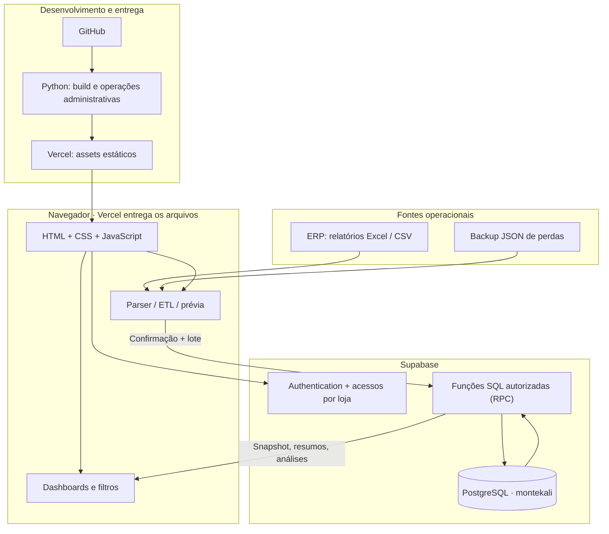
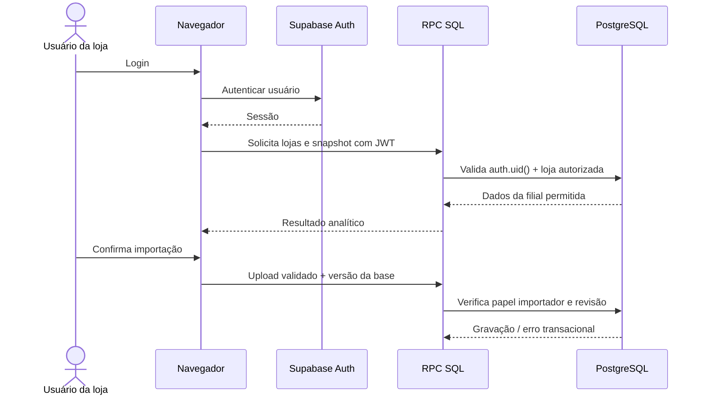

# Arquitetura técnica · Z-AI Gestão Visual

[← README](../README.md) · [ETL](ETL_E_IMPORTACOES.md) · [Indicadores](DASHBOARDS_E_INDICADORES.md) · [Vercel](DEPLOY_VERCEL.md) · [Roadmap](ROADMAP.md)

> **Estado documentado:** outubro de 2026, piloto **Loja 007 — Kalimera Japy**. Esta documentação descreve o repositório e o fluxo atual, não uma integração hipotética em tempo real.

## 1. Objetivo arquitetural

Um **frontend estático** trata a interação e as prévias de arquivos, enquanto o **PostgreSQL no Supabase** armazena dados e executa operações de negócio autenticadas. O mesmo banco sustenta os oito módulos; não há bancos independentes por dashboard nem cópia da base comercial em cada tela.

O fluxo de manutenção é **GitHub (código) → implantação Vercel (web) → Supabase (dados)**. Os dados persistem no Supabase; republicar o frontend não deve sobrescrever as bases.

A seta GitHub → Python → Vercel representa o **processo de build disponível**. A vinculação automática de commits a deploys depende de configuração de CI; algumas implantações ocorreram por publicação manual via API.

## 2. Repositório e responsabilidades

| Arquivo/diretório | Responsabilidade |
|---|---|
| `web/index.html` | Casca da interface, campos globais, login, navegação, inclusão de CSS e JS |
| `web/style.css` | Estilos-base e componentes |
| `web/corporate.css` | Linguagem visual corporativa, composição e layout |
| `web/analytics.css` | Ajustes de apresentação de gráficos, tabelas e páginas analíticas |
| `web/core.js` | Funções puras de cálculo, calendário, cobertura, metas e seleções; compartilha lógica com testes |
| `web/app.js` | Menus, renderização, importadores, autenticação, ETL, páginas de Vendas/Trocas, upload e histórico |
| `web/ui.js` | Componentes e interação para Perdas Reconhecidas e Auditorias, paginação e navegação |
| `web/config.example.js` | Exemplo de configuração pública — copiar para `web/config.js` localmente |
| `database/*.sql` | Esquema, permissões, migrações, importações, indicadores, consultas e reversões |
| `tools/build_frontend.py` | Copia `web/` para `dist/` e gera `config.js` com variáveis **públicas** de build |
| `tools/02_importar_backup.py` | Carga inicial de backup legada; valida antes de gravar |
| `tools/06_converter_perdas.py` | Conversão local de layout de perdas do ERP |
| `tools/09_carregar_diario_historico.py` | Carga administrativa conferida de histórico diário, com proteção de sobreposição |
| `tools/10_atualizar_base_local.py` | Conciliação **offline** entre backup legado e base analítica |
| `tests/*.cjs` e `tests/test_*.py` | Testes de regressão, cálculos e transformações |
| `netlify.toml` | Configuração alternativa/legada; **não é a configuração da Vercel** |
| `.gitignore` | Protege dados de operação, backups, arquivos de entrada, segredos e build da publicação no Git |

O frontend não depende de React, Vue, Angular ou Next.js: foi desenvolvido em **JavaScript nativo**. O uso de **SheetJS/XLSX** é pontual para leitura de planilhas. Scripts de Python usam, conforme o caso, `openpyxl` e `psycopg`.

## 3. Camada de dados

Principais estruturas lógicas sob o esquema `montekali` (os nomes exatos devem ser conferidos nas migrações conforme a versão de cada ambiente):

| Grupo | Estruturas principais |
|---|---|
| Governança | `lojas`, `acessos`, `revisoes`, `configuracao_painel` |
| Cadastros | `departamentos`, `produtos` |
| Vendas | `vendas`, `vendas_mensais`, `cobertura_vendas`, `vendas_resumo_dia`, `vendas_resumo_produto_mes` |
| Perdas | `perdas`, `auditoria_substituicoes` |
| Inventário | `auditorias_estoque` |
| Trocas | `trocas_posicao`, `trocas_snapshots`, `trocas_regras_fornecedor` |
| Rastreabilidade | `lotes_importacao` |

### IDs, grão analítico e dimensões

- **Chaves de loja, data, SKU e departamento** delimitam a maioria das consultas.
- **Movimento de perdas** é uma ocorrência identificável; não deve ser consolidado apagando recorrências legítimas.
- **Vendas diárias** podem ser agrupadas por `loja + data + SKU + departamento`.
- **Auditoria** mantém direção da movimentação: `entrada`/sobra e `saida`/falta.
- **Trocas** são uma *posição atual*, não uma soma de fotografias históricas. `trocas_snapshots` guarda referência, não saldo acumulável.
- **Lote** registra proveniência (`arquivo_nome`, hash, tipo, horário, quantidade, valores e metadados).

### Funções RPC consumidas pelo frontend

- `zai_lojas`: filiais autorizadas ao usuário.
- `zai_snapshot`: visão analítica para a loja selecionada.
- `zai_importar_vendas`, `zai_importar_perdas`, `zai_importar_auditorias`, `zai_importar_trocas`: cargas transacionais.
- `zai_auditorias_periodo`: consulta detalhada e ordenação/paginação das auditorias.
- `zai_vendas_produtos_periodo`: vendas por produto no recorte solicitado.
- `zai_historico_importacoes` e `zai_desfazer_importacao`: auditoria de lotes e reversão condicionada.

Muitas funções são `SECURITY DEFINER` para encapsular acesso controlado às tabelas; por isso, devem **validar `auth.uid()`, loja e perfil dentro da função**. O acesso anônimo à operação de desfazer foi explicitamente revogado. Não conceda execução irrestrita de funções privilegiadas.

## 4. Segurança e isolamento por loja

**Papéis presentes no banco:** `consulta` e `importador`. Usuários sem permissão de importação não podem gravar/desfazer por meio dessas RPCs. Perfis administrativos multiloja adicionais são uma possibilidade de evolução, **não uma implementação comprovada do painel atual**.

**Segredos:** publicar somente URL HTTPS e chave `sb_publishable_...` da API. Jamais enviar credenciais administrativas, string de conexão PostgreSQL ou `service_role` ao navegador. A pasta `data/` é privada e ignorada.

## 5. Responsabilidades por camada

**Navegador** — identifica formato, padroniza valores/datas/códigos, mantém a prévia, valida seleção e exibe indicadores. Não possui credenciais de superusuário.

**RPC e banco** — verificam identidade, permissão, versão da base, duplicidade, tipos de dado e consistência antes de gravar. A atualização deve ser atômica por lote e manter histórico.

**Resumos analíticos** — usam somatórios calculados no PostgreSQL e dados do snapshot autorizado; filtros devem preservar cobertura temporal e grão do produto. O mês não deve duplicar o diário.

**Vercel** — apenas entrega o frontend. O código público não inclui dados da operação. Um deploy READY não equivale automaticamente a HTTP 200: conferir assets e `/index.html`.

## 6. Decisões técnicas e limites conhecidos

- **Sem integração ERP automática** nesta fase: a origem é arquivo exportado pelo ERP e conferido pelo operador.
- **Sem API de back-end própria em PHP/Python**: as operações de banco são RPCs SQL, e o app usa JS.
- **Sem atualização automática de custos/estoques** para prever compras; giro/cobertura exigirão mais dados.
- **Sem ficha completa Produto 360°** por enquanto; os dados existem separados em módulos e devem ser reunidos por chave/cobertura.
- **Vendas mensais + vendas diárias** não são somadas indiscriminadamente. Cobertura comparável governa percentuais.
- **Rastreabilidade** prioriza manter histórico em vez de apagar registros de importação. Reversão só quando dependências e restauração forem seguras.
- **Escala multiloja** exige testar layouts operacionais de cada filial, cadastros e roles; a Loja 007 continua sendo a unidade homologada.

Consulte [ETL e Importações](ETL_E_IMPORTACOES.md) para contratos de entrada e [Roadmap](ROADMAP.md) para os próximos passos.
