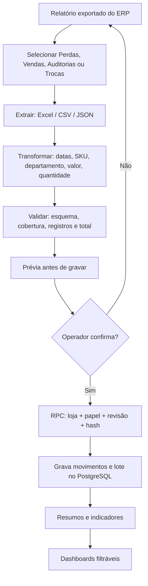

# ETL e Central de Importações

[← README](../README.md) · [Arquitetura](ARQUITETURA.md) · [Dashboards](DASHBOARDS_E_INDICADORES.md) · [Roadmap](ROADMAP.md)

## Ideia do projeto: importar é mais fácil que montar um dashboard

O Z-AI permite atualizar **oito páginas de análise** usando uma rotina operacional comum: **exportar arquivo no ERP → escolher a categoria → conferir a prévia → confirmar gravação**. A equipe não precisa criar fórmulas, tabelas dinâmicas ou gráficos do zero a cada atualização.

A solução combina duas etapas:

- **ETL no frontend JavaScript:** lê e interpreta o arquivo de origem, normaliza campos, rejeita registros inválidos e apresenta a prévia.
- **Validação + carga transacional no Supabase/PostgreSQL:** aplica a regra da categoria (complementar ou substitutiva), valida permissão e integridade, identifica o lote e atualiza o resumo analítico.

## Os cinco estágios

### 1. Extração (Extract)

**Entrada:** arquivo gerado no ERP, sem precisar separar previamente um mês em várias planilhas.

O navegador usa a biblioteca **SheetJS/XLSX** para planilhas `.xlsx`/`.xls`, leitura de CSV e parser de JSON. O importador identifica colunas e cabeçalhos reconhecidos. Uma categoria errada pode até apresentar colunas plausíveis: **sempre confira a prévia antes de gravar**.

Cada tipo tem parser próprio, em `web/app.js`:
`parseSalesFile`, `parseLossFile`, `parseAuditFile`, `parseTrocasFile`.

### 2. Tratamento (Transform)

- **Datas:** converte formato brasileiro `DD/MM/AAAA` ou data do Excel para `AAAA-MM-DD`, usando calendário UTC para evitar deslocamento de um dia por fuso horário.
- **Produtos:** converte identificador em **SKU texto** para não aplicar operações matemáticas ao código.
- **Departamentos:** padroniza códigos (por exemplo, `15` → `015`) e valida existência no cadastro da loja.
- **Valores e quantidades:** interpreta número decimal e recusa número ausente/inválido onde exigido; não atribui zero a um campo faltante de forma silenciosa.
- **Linhas agrupáveis:** combina registros repetidos somente quando a lógica daquele importador permite, sem apagar ocorrências de perdas que precisam ser preservadas.
- **Categorias de perdas:** classificação por motivo: vencido, avariado, deteriorado e outros reconhecidos.
- **Trocas:** mantêm categoria original, mas consolidam analiticamente `elas_por_elas` e `produto_por_produto` como `troca_produto`.

### 3. Validação de qualidade (Validate)

Antes da gravação, a **prévia** apresenta:

- Arquivo e tipo selecionado.
- Linhas lidas e registros normalizados, conforme o importador.
- Datas/cobertura, quantidades e **valor total**.
- Regras de adição ou substituição (inclusive dias que serão substituídos).
- Confirmação explícita de responsabilidade do operador.

Validações adicionais ocorrem no banco: **acesso à loja, papel importador, revisão do snapshot, identificador/hash do arquivo, campos obrigatórios, coerência dos movimentos e duplicidades**.

Se o operador identificar erro na prévia, cancela sem enviar movimentos. O frontend não deve gravar automaticamente ao selecionar um arquivo.

### 4. Carga (Load)

O frontend chama funções `/rest/v1/rpc/zai_importar_...` via sessão autenticada. O PostgreSQL executa as mudanças conforme o contrato de cada tipo, registra em `montekali.lotes_importacao` e atualiza `montekali.revisoes`.

**Não há uma única regra de importação para todas as bases.**

| Tipo | Atualização | Motivo |
|---|---|---|
| Vendas | **Substituir os dias completos do arquivo** | Evitar duplicar faturamento em reimportação |
| Perdas reconhecidas | **Complementar** ou **substituir dias** | Distinguir nova ocorrência de relatório integral |
| Auditorias de estoque | **Somente complementar** | Preservar lançamentos de entrada/saída e evitar sobreposição |
| Trocas | **Substituir posição atual** | Uma posição diária é um snapshot, não uma venda/movimentação acumulável |

### 5. Disponibilização analítica (Analyze)

Os resultados abastecem o snapshot e as consultas detalhadas. O frontend filtra por loja, período e departamento; outras páginas adicionam **SKU, motivo, marca, fornecedor, tratativa, tipo e modo individual/agrupado**.

**ETL ≠ automatização do ERP:** a transformação após o upload já é automática; a extração a partir do sistema de origem ainda é manual.

---

## Contrato de Vendas

**Layout horizontal:** colunas do cadastro do produto e blocos repetidos por data:

| SKU | Descrição | Departamento | 14/10 — Vendas | 14/10 — Quantidade | 14/10 — Ct Empresa | 15/10 — Vendas | 15/10 — Quantidade |
|---|---|---|---:|---:|---:|---:|---:|
| 1001 | Produto fictício A | 015 | 120,00 | 5 | 80,00 | 0 | 0 |
| 1002 | Produto fictício B | 021 | 35,00 | 2 | 24,00 | 50,00 | 3 |

*Exemplo didático. Os cabeçalhos efetivos do arquivo do ERP devem seguir o parser.*

- **Vendas** forma a receita; **Quantidade** preserva volume. **Ct Empresa não é faturamento.**
- Datas com **Vendas = 0 e Quantidade = 0** em todas as linhas são ignoradas na cobertura importada.
- São geradas combinações por **data + SKU + departamento**.
- O frontend separa automaticamente em **lotes de dias completos**, usando limite de segurança na quantidade de registros. O operador continua enviando **um único Excel**.
- Cada lote possui hash composto e identificação; a RPC `zai_importar_vendas` trabalha com versão da base e a lista de datas inteiras.
- A gravação substitui os dias declarados pelo arquivo, mantendo os movimentos anteriores no metadado de histórico, quando aplicável.

### Atenção ao fuso horário

Houve uma falha identificada e corrigida em outubro de 2026: datas interpretadas como `Date` e convertidas pelo fuso local deslocavam o dia para a véspera. O parser agora utiliza componentes **UTC** e tem teste dedicado em `tests/importador_vendas.cjs`.

**Teste recomendado:** validar que um dia `20/10/2026` corresponde a `2026-10-20` na prévia, no banco e nos cartões. Não usar só o nome do arquivo para afirmar a data gravada.

---

## Contrato de Perdas Reconhecidas

**Origem:** planilha operacional de quebras ou backup JSON com esquema conhecido.

**Campos analíticos:** `data`, `sku`, `produto`, `dpto`, `motivo`, `qtde`, `valor`.

- **Complementar:** adiciona novas ocorrências, verificando possíveis duplicidades na base.
- **Substituir dias:** considera o arquivo completo para as datas selecionadas. Pode apagar e repor dados desses dias; exige conferência reforçada.
- **Individual × agrupado:** o detalhe preserva cada movimentação; o agrupamento evidencia recorrências.
- **Categorias:** vencidos, avariados, deteriorados e outros, sem descartar o motivo original registrado pelo ERP.

Valores monetários são os do próprio lançamento reconhecido. Não confundir `Ct Médio` com custo unitário se o layout efetivo usar o campo como **total da linha**; o conversor legado documenta essa regra do piloto.

---

## Contrato de Auditorias de Estoque

**Origem:** Excel com entradas e saídas, data da movimentação, código de produto, descrição, departamento, quantidade, valor, documento e espécie/origem.

| Movimento no ERP | Leitura no Z-AI | Impacto |
|---|---|---|
| **Saída** | **Falta de estoque** | Aumenta o valor de perdas desconhecidas |
| **Entrada** | **Sobra de estoque** | Compensa o resultado líquido |

`Resultado líquido = Faltas − Sobras`.

- A carga é **complementar**: não substitui dias anteriores.
- Os filtros de Auditorias permitem consulta de movimentos **individuais** e valores **agrupados por SKU**.
- A ordenação global padrão prioriza **todas as faltas**, da maior para a menor, seguidas pelas **sobras**, também em ordem de valor.
- No detalhe, paginação e busca são tratadas por consulta SQL, evitando ordenar apenas o recorte local da tela.

Há proteções para impedir que a mesma carga ou o mesmo movimento reconhecido seja somado duas vezes. Uma falta e uma sobra no mesmo SKU **não se tornam iguais a zero no histórico**; cada direção continua rastreável.

---

## Contrato de Trocas

**Origem:** Excel de posição atual do estoque aguardando troca, com fornecedor, marca/produto, SKU, departamento, quantidade, custo/valor, curva e data de referência.

A importação é do tipo **snapshot de posição**, não movimento incremental:

1. Lê o arquivo e identifica a data de referência.
2. Normaliza os produtos e fornecedores.
3. Confere o total da nova posição.
4. **Substitui a posição vigente** por uma única posição atual.
5. Mantém os snapshots históricos para investigação, sem somar seus valores ao estoque presente.

A classificação é uma regra cadastrada por fornecedor, não um palpite baseado em nomes. Categorias operacionais contemplam **NF de devolução**, **Elas por elas / Produto por produto**, **Bonificação**, **Mista** e **Sem cadastro**.

Na página **Estoque de Trocas**, filtros por **fornecedor, marca, tratativa e produto** também recortam o CSV exportado para vendedor.

---

## Trilha de auditoria, exclusões e restauração

O histórico de lote é diferente de uma tabela descartável. Metadados incluem arquivo, data de importação, tipo, contagem, valor, hash e dados anteriores quando disponíveis.

A **Central de Importações** disponibiliza o botão **Desfazer** para lotes elegíveis:

1. Usuário deve estar autenticado, autorizado para a loja e possuir papel `importador`.
2. Informa justificativa com pelo menos 10 caracteres e confirma digitando **DESFAZER**.
3. A RPC confronta revisão, integridade do lote e dependências.
4. Só remove os movimentos do lote permitido; **restaura dados anteriores** de vendas quando existir backup válido e a substituição ainda for reversível.
5. Atualiza cobertura/resumos e mantém o lote histórico marcado como `desfeito`, com motivo e usuário.
6. Lotes sem pré-condições para reversão ficam **protegidos** para correção administrativa.

**Não usar exclusão direta de banco para “limpar histórico”.** Uma carga antiga pode ter substituído movimentos legítimos; é necessário conferir snapshot anterior e dependências.

**Caso auditado no piloto:** o arquivo `21-10.xlsx` foi importado incorretamente como **Vendas** (lote 52, 142 registros, R$ 3.768,04) e depois como **Perdas** (lote 53). O lote 52 foi desfeito no Supabase; o lote 53 foi preservado. Esse caso motivou o mecanismo geral de reversão.

---

## Checklist de qualidade antes de confirmar

- [ ] Loja correta selecionada
- [ ] Categoria do arquivo correta (Vendas, Perdas, Auditorias ou Trocas)
- [ ] Datas e número de registros conferidos
- [ ] Valor total e quantidades coerentes com o ERP
- [ ] Tipo de atualização correto (complementar ou substituição)
- [ ] Cadastros de departamentos e produtos reconhecidos
- [ ] Nenhuma data indevida ou zerada aparece como cobertura completa
- [ ] O efeito sobre períodos existentes está compreendido
- [ ] Confirmação registrada; histórico consultável após a gravação

## Arquivos e pontos de manutenção

- **Parsers/ETL:** `web/app.js` (`parse*File`, `preview*`, `salesBatches`, `commitImport`).
- **Validação SQL:** migrações em `database/`; lógica nas RPCs de importação.
- **Histórico e reversão:** `database/22_desfazer_importacoes.sql`.
- **Regressão de datas/lotes:** `tests/importador_vendas.cjs`.
- **Conciliação local administrativa:** `tools/10_atualizar_base_local.py`.

[Próximo: dashboards e significado dos indicadores →](DASHBOARDS_E_INDICADORES.md)
